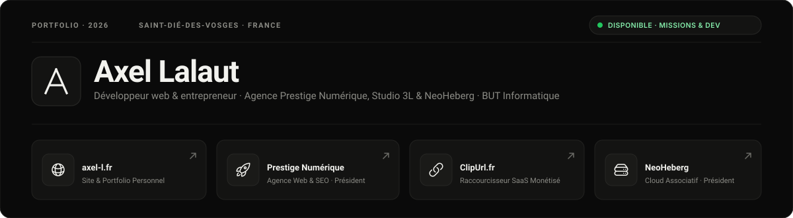

  

    

  

    

  
  
  
  
  

 

---

### 🌟 À Propos

  <b>Entrepreneur passionné et développeur polyvalent</b>, je crée et propulse des projets numériques performants, esthétiques et pensés pour la conversion. Mon approche allie <b>rigueur technique</b>, <b>design soigné</b> et <b>vision stratégique ROI</b>.

<table>
  <tr>
    <td width="50%" valign="top">
      <h4>💼 Entrepreneuriat &amp; Stratégie</h4>
      <ul>
        <li>Fondateur et dirigeant d'une agence digitale premium</li>
        <li>Présidence et gestion d'infrastructures associatives</li>
        <li>Création de SaaS et produits monétisés</li>
      </ul>
    </td>
    <td width="50%" valign="top">
      <h4>⚡ Ingénierie &amp; Full-Stack</h4>
      <ul>
        <li>Architecture web haute performance (Node.js, PHP, JS/TS)</li>
        <li>Développement d'applications Desktop (Electron) et Mobiles (Flutter)</li>
        <li>Administration système Linux, serveurs VPS &amp; Cloud</li>
      </ul>
    </td>
  </tr>
</table>

---

### 🚀 Mes Projets Phares &amp; Entreprises

<table width="100%">
  <tr>
    <td width="50%" align="center" valign="top">
       
      
        
      <b>axel-l.fr</b>
       
      
        
      

        <b>Site personnel, portfolio &amp; vitrine technique.</b>
         
        Présentation complète de mes compétences, veille technologique, parcours d'études en BUT Informatique et récapitulatif de mes réalisations.
      

      

        <code>HTML5</code> <code>CSS3</code> <code>JS</code> <code>Performance</code> <code>SEO</code>
      

       
      
        
    </td>
    <td width="50%" align="center" valign="top">
       
      
        
      <b>Agence Prestige Numérique</b>
       
      
        
      

        <b>Agence web &amp; stratégie digitale premium.</b>
         
        Création de sites internet sur-mesure, optimisation SEO avancée, e-commerce et stratégies d'acquisition orientées rentabilité.
      

      

        <code>HTML5</code> <code>CSS3</code> <code>JS</code> <code>PHP</code> <code>SEO</code>
      

       
      
        
    </td>
  </tr>
  <tr>
    <td width="50%" align="center" valign="top">
       
      
        
      <b>ClipUrl.fr</b>
       
      
        
      

        <b>Raccourcisseur de liens monétisé &amp; SaaS.</b>
         
        Plateforme permettant aux créateurs et éditeurs de monétiser leur audience avec liens raccourcis, tableau de bord et analytics temps réel.
      

      

        <code>Node.js</code> <code>MySQL</code> <code>API REST</code> <code>SaaS</code>
      

       
      
        
    </td>
    <td width="50%" align="center" valign="top">
       
      
        
      <b>NeoHeberg</b>
       
      
        
      

        <b>Hébergement associatif &amp; Cloud gratuit.</b>
         
        Solutions d'hébergement performantes et ouvertes pour développeurs : environnements Node.js, Python, bases de données et serveurs VPS.
      

      

        <code>Linux</code> <code>VPS</code> <code>Python</code> <code>Cloud</code> <code>DevOps</code>
      

       
      
        
    </td>
  </tr>
</table>

---

### 📊 Activité &amp; Métriques GitHub

  

    

  <table border="0" cellpadding="0" cellspacing="0">
    <tr>
      <td align="center" valign="top">
        
      </td>
      <td align="center" valign="top">
        
      </td>
    </tr>
  </table>

   

  

---

### 🧰 Stack &amp; Arsenal Technique

  

    

<table>
  <tr>
    <td width="50%" valign="top">
      <b>🎨 Frontend &amp; UI</b>  
      
      
      
      
      
    </td>
    <td width="50%" valign="top">
      <b>⚙️ Backend &amp; Systèmes</b>  
      
      
      
      
      
      
    </td>
  </tr>
  <tr>
    <td width="50%" valign="top">
      <b>📱 Desktop &amp; Cross-Platform</b>  
      
      
    </td>
    <td width="50%" valign="top">
      <b>☁️ Cloud, DevOps &amp; Données</b>  
      
      
      
      
      
    </td>
  </tr>
</table>

---

### 🤝 Travaillons Ensemble !

  <b>Vous avez un projet innovant, un besoin en développement sur-mesure ou une infrastructure à bâtir ?</b> 
  Échangeons sur vos ambitions et donnons vie à vos idées.

  
  
  
  
  

